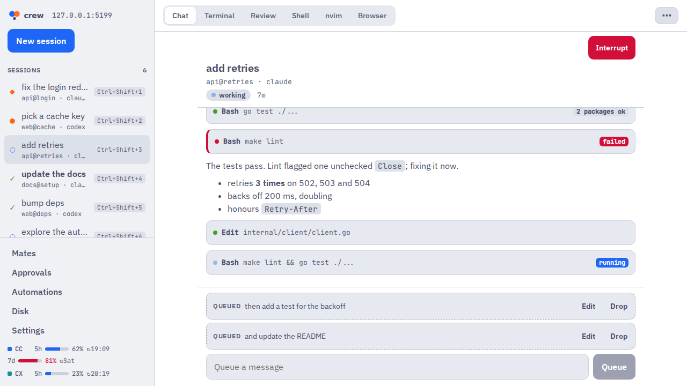
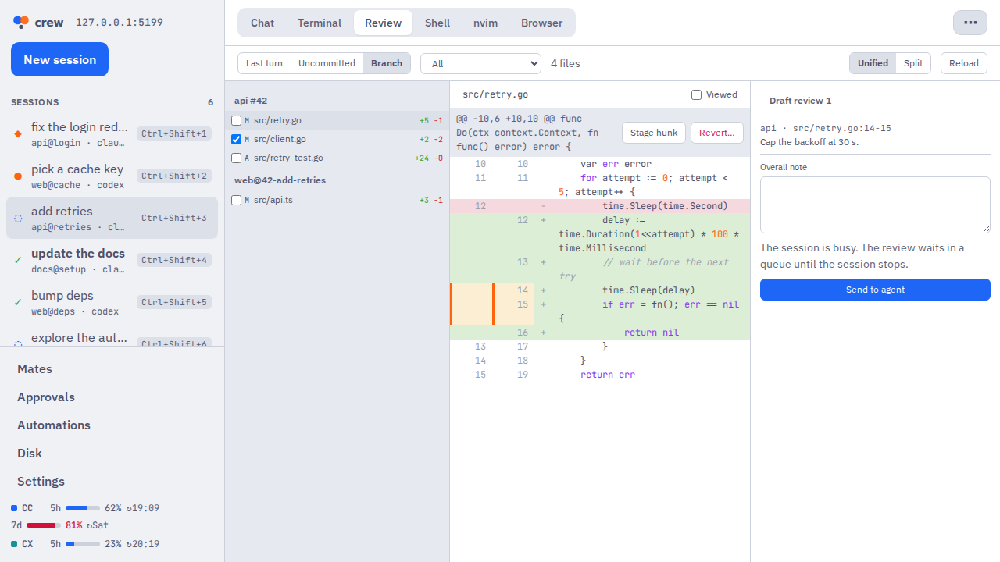
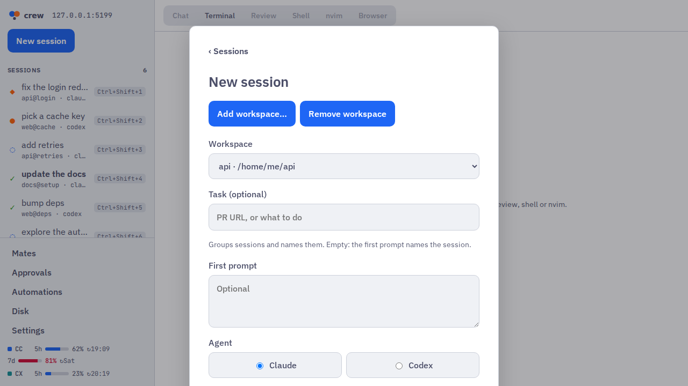
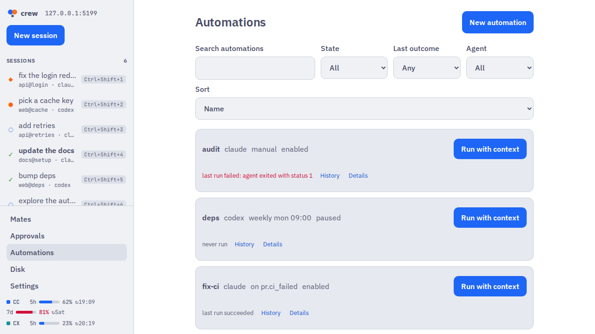
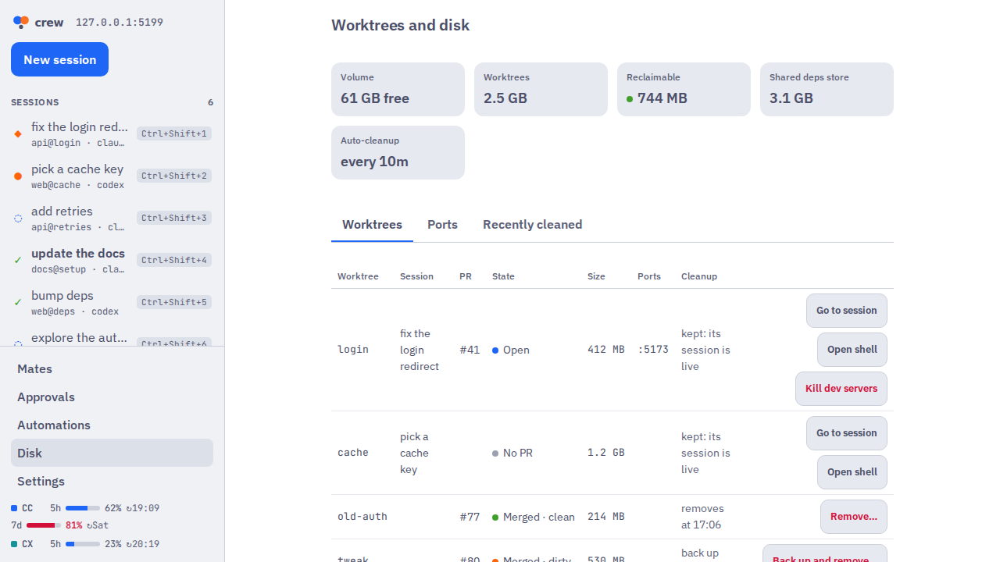
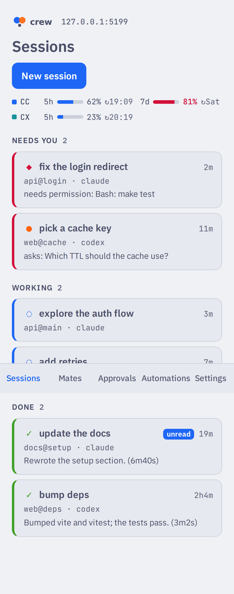
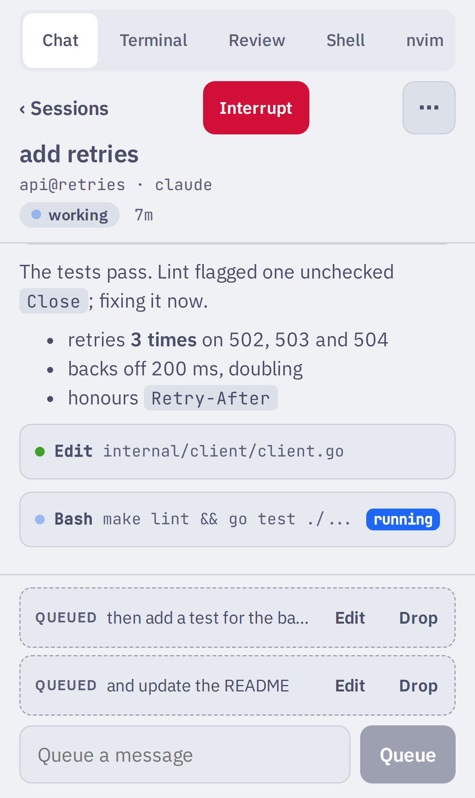

<p align="center">
  <picture>
    <source media="(prefers-color-scheme: dark)" srcset="docs/images/brand/crew-wordmark-mocha.svg">
    
  </picture>
</p>

<p align="center"><b>Run a crew of coding agents in parallel. Review their work like a PR. Step in only when they need you.</b></p>

<p align="center">
  <a href="https://github.com/giovaniif/crew/releases"></a>
  <a href="https://github.com/giovaniif/crew/actions/workflows/ci.yml"></a>
</p>



crew runs Claude Code and Codex sessions side by side, each in its own git worktree. It tells you which session needs you, shows each change in a local, PR-style review, and removes the worktree when its PR merges. Use it from the desktop app (macOS and Linux), the terminal (TUI) or your phone.

## Features

- **Parallel agents, no mess.** Each session works in its own worktree. crew removes the worktree when the PR merges. It never deletes a branch, and it backs up uncommitted work first.
- **Attention.** The sidebar shows the state of each session: ◆ permission, ● waiting, ◌ running, ✓ done. A session that needs you goes to the top, with a notification on your computer or your phone. The quota bar shows the Claude and Codex limits.
- **Review like a PR.** See the last turn, the uncommitted changes or the whole branch. Comment on lines, stage or revert one hunk, and send all comments to the agent as one prompt.
- **New sessions.** Select a workspace, a task (a PR URL or text), the agent, the model and the effort. crew makes the worktree and runs the setup recipe of the repo (`.crew.toml`).
- **Automations.** Define `[[automation]]` tables in `config.toml` or in `.crew.toml`. Run them by hand, on a schedule or on an event such as a failed CI.
- **Browser.** Agents control a browser for each session with `crew browser`. When no desktop app is connected, the daemon can use a headless Chromium ([ADR 0054](docs/adr/0054-headless-browser-fallback.md)).
- **Disk and cleanup.** See the size and state of each worktree, the dev servers on its ports, and what cleanup will do and when.
- **Terminal and nvim.** All of crew also works in the TUI. The nvim plugin sends review comments from nvim.
- **Phone.** `crew serve` gives the same app to your phone. See [docs/remote-app.md](docs/remote-app.md).

<p>
  
  
  
  
</p>

<p>
  
  
  
</p>

## Install

crew runs on macOS and Linux. Windows is not supported. You need `tmux`, `git` and the GitHub CLI (`gh`, signed in). You also need Claude Code, the Codex CLI or both. For the nvim integration, you need Neovim 0.10+. For `:CrewDiff`, you also need [diffview.nvim](https://github.com/sindrets/diffview.nvim).

### Desktop app

Get the package from [GitHub Releases](https://github.com/giovaniif/crew/releases). Each package holds the matching `crew` binary, and the app starts its own `crew serve`. You do not need to install the CLI first.

| OS | File | Install |
|---|---|---|
| macOS (Apple silicon) | `crew_<version>_aarch64.dmg` | Open it and drag `crew.app` to Applications. The app is signed and notarized. |
| macOS (Intel) | `crew_<version>_x64.dmg` | The same as Apple silicon. |
| Linux (amd64) | `crew_<version>_amd64.AppImage` | `chmod +x crew_<version>_amd64.AppImage`, then run it. |
| Linux (amd64) | `crew_<version>_amd64.deb` | `sudo apt install ./crew_<version>_amd64.deb`. Then start `crew-desktop`. |

### Phone

The phone app connects to a `crew serve` on your computer or server. Pair it with `crew remote pair`.

- **iOS:** the app is on TestFlight. Ask the maintainer for an invite.
- **Android:** a store build is not available yet. Each CI run on `main` has a debug APK (the `crew-android-debug` artifact).
- **All phones:** open `crew serve` in the browser and add it to the Home Screen (a PWA).

**Do not open `serve` to the internet, unless a layer in front of it adds its own authentication.** The setups for Tailscale, a LAN or VPN behind Caddy or nginx, and Cloudflare Tunnel are in [docs/remote-app.md](docs/remote-app.md).

### CLI

Install the newest release of `crew` and its nvim plugin:

```sh
curl -fsSL https://raw.githubusercontent.com/giovaniif/crew/main/scripts/install.sh | sh
```

The script downloads the tarball for your OS and CPU (macOS or Linux, amd64 or arm64) from GitHub Releases, and checks it against `checksums.txt`. It puts `crew` in `~/.local/bin` and the nvim plugin in `~/.local/share/crew/nvim`. Set `CREW_VERSION` for a specific release, or `CREW_INSTALL_DIR` for another directory. You can also download a tarball from the release page.

```sh
crew version   # crew v0.1.0-beta.1 (commit abc1234)
```

Optional, on macOS: `brew install terminal-notifier`. Then a click on a banner shows your terminal on that session.

### Upgrade

The desktop app updates itself and its `crew` binary. At launch and each 6 h, it looks for a newer release. It asks you before it installs.

`crew version` checks GitHub for a newer release at most one time each day. To stop this check, set `CREW_NO_UPDATE_CHECK=1`. The `crew` binary does not update itself. To upgrade, run the install script again, then stop the old daemon:

```sh
curl -fsSL https://raw.githubusercontent.com/giovaniif/crew/main/scripts/install.sh | sh
crew daemon stop
crew
```

The alpha releases had another name. The first start of `crew` moves your old state to `~/.crew` one time, and writes one line for each step.

## Quick start

1. Run `crew`. The first time, a setup screen opens.
2. Select Claude Code, Codex or both. The screen shows the file that it changes (`~/.claude/settings.json` or `~/.codex/hooks.json`), where the backup goes, and how to undo it (`crew setup claude --remove`). Codex then needs a one-time trust step: start `codex` and accept the review prompt for the new hooks.
3. Optional: set up Neovim. It writes `~/.config/nvim/plugin/crew.lua` and does not edit your own files.
4. Press `n` to start your first session.

To open the setup screen again, press `S` in the sidebar or run `crew setup`. More: [docs/getting-started.md](docs/getting-started.md).

## How it works

`crew` is one Go binary. It is the daemon, the TUI, the CLI and the hook handler. The Claude Code and Codex hooks (`crew hook`) send each state change to the daemon. The agents run in the `crew` tmux server. crew uses the `git`, `gh` and `tmux` CLIs. `crew serve` gives an HTTP and WebSocket API to the desktop and phone apps. More: [ARCHITECTURE.md](ARCHITECTURE.md).

## Develop

The build is test-driven, and CI enforces it. Read [AGENTS.md](AGENTS.md) before you open a PR. It covers the layer rules, tests first, no comments, and one PR per issue.

- `make build`, `make test`, `make lint` and `make e2e` are the main commands.
- `make dev SEED=3 FAKES=1` runs crew from the checkout with demo data.
- `make readme-shots` makes the images of this README.

## Docs

- [FEATURES.md](FEATURES.md): what crew does.
- [ARCHITECTURE.md](ARCHITECTURE.md): the layers and the performance budgets.
- [docs/getting-started.md](docs/getting-started.md): the first run.
- [docs/remote-app.md](docs/remote-app.md): the phone app and remote access.
- [docs/adr/](docs/adr/): the decisions.
- [docs/style.md](docs/style.md): the writing style.

## Status

crew is in **beta**. Report a bug or an idea in [GitHub Issues](https://github.com/giovaniif/crew/issues). Include the output of `crew version` and, for the daemon, `~/.crew/daemon.log`.
