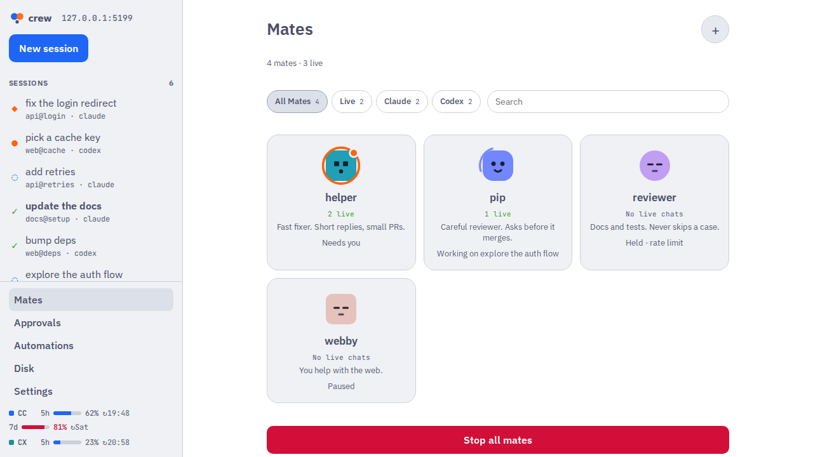
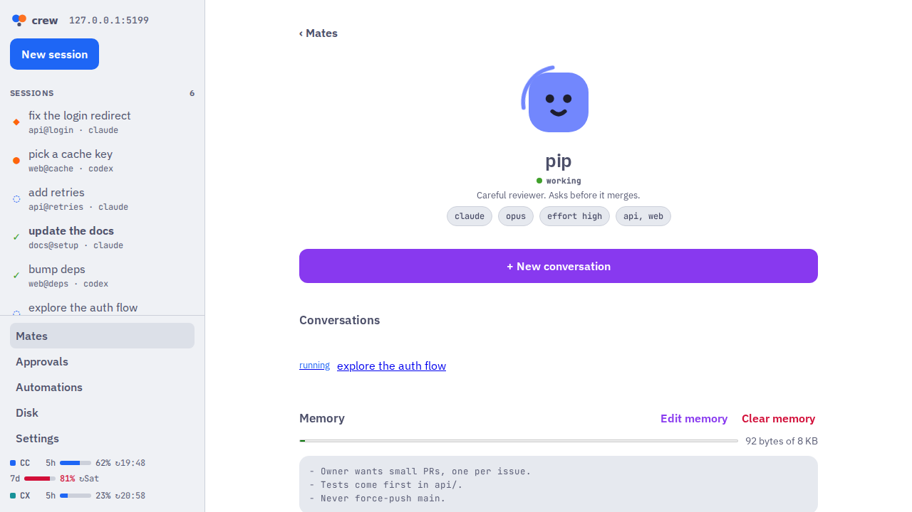

<h1 align="center">
   crew
</h1>

<p align="center">
  <a href="https://github.com/giovaniif/crew/stargazers"></a>
  <a href="https://github.com/giovaniif/crew/releases"></a>
  <a href="https://github.com/giovaniif/crew/actions/workflows/ci.yml"></a>
  
  <a href="#phone"></a>
  <a href="https://github.com/giovaniif/crew/actions/workflows/ci.yml?query=branch%3Amain"></a>
</p>

<p align="center">
  <strong>Run a crew of coding agents in parallel. Review their work like a PR.</strong><br>
  Give each task to a session in its own worktree, or to a <b>mate</b>: a crew personality with its own tone and memory, in the app or in Slack.
</p>

<h3 align="center"><a href="https://github.com/giovaniif/crew/releases"><ins>Download crew</ins></a></h3>

<p align="center">
  
</p>

## Features

<table>
<tr>
<td colspan="2">

### Mates: your crew, with a personality

A mate is a named personality of crew. Each mate has its own prompt, tone, agent, model, repos and memory file. Start a new conversation with a mate at any time. It keeps its personality and its notes. Mates work in the app with no Slack setup. Connect a mate to Slack, and your team can mention it in a thread. Each thread becomes a session.

- **Tone controls:** set terse or chatty, cautious or bold, formal or playful. Each step adds one sentence to the prompt.
- **Memory:** the mate writes decisions and facts to its own `memory.md`. You can edit or clear it. "Start fresh" writes a handoff, then starts a new conversation.
- **Safe-action gate:** in Slack, a dangerous action from a person who is not the owner stops in the hook, not in the prompt. The owner approves or denies it in Slack, on the phone or in the app. A kill switch stops all mates.
- **Everywhere:** the Mates page in the desktop and phone apps, `C` in the TUI, and `crew mate add`, `crew mate new` and `crew mate slack` in the CLI.

[Docs →](docs/adr/0056-local-mates.md) · [Slack and the gate →](docs/adr/0053-mates.md)

 

</td>
</tr>
<tr>
<td width="50%" valign="top">

### Parallel agents in worktrees

Start Claude Code, Codex or Oh My Pi sessions side by side. Each session works in its own git worktree, so the agents never change the same files.

[Docs →](FEATURES.md)


</td>
<td width="50%" valign="top">

### Review like a PR

See the last turn, the uncommitted changes or the whole branch. Comment on lines, stage or revert one hunk, and send all comments to the agent as one prompt.

[Docs →](docs/adr/0028-review-comments-and-hunks.md)


</td>
</tr>
<tr>
<td width="50%" valign="top">

### Your phone, paired

`crew serve` gives the same app to your phone: iOS, Android or a PWA. Pair it with a code from `crew remote pair`. A session that needs you sends a push notification.

[Docs →](docs/remote-app.md)


</td>
<td width="50%" valign="top">

### New session in seconds

Select a workspace, a task (a PR URL or text), the agent, the model and the effort. crew makes the worktree and runs the setup recipe of the repo (`.crew.toml`).

[Docs →](docs/getting-started.md)


</td>
</tr>
<tr>
<td width="50%" valign="top">

### Automations

Define `[[automation]]` tables in `config.toml` or `.crew.toml`. Run them by hand, on a schedule or on an event such as a failed CI.

[Docs →](docs/adr/0050-automations.md)


</td>
<td width="50%" valign="top">

### Disk and safe cleanup

See the size of each worktree and the dev servers on its ports. crew removes a worktree when its PR merges. It never deletes a branch, and it backs up uncommitted work first.

[Docs →](docs/adr/0021-worktree-cleanup.md)


</td>
</tr>
<tr>
<td width="50%" valign="top">

### Terminal and nvim

All of crew also works in the TUI. The sidebar puts the session that needs you at the top. The nvim plugin sends review comments from nvim.

[TUI →](internal/tui/AGENTS.md) · [nvim →](nvim/AGENTS.md)


</td>
<td width="50%" valign="top">

### Browser tab and CLI

Agents control a browser for each session with `crew browser`. With no desktop app, the daemon uses a headless Chromium. The `crew` CLI does all of the other steps from a script.

[Docs →](docs/adr/0059-tauri-browser-tab.md) · [CLI →](cmd/crew/AGENTS.md)


</td>
</tr>
</table>

**Also in the box:** the quota bar for the Claude and Codex limits, the session states (◆ permission, ● waiting, ◌ running, ✓ done), notifications on your computer and your phone, and a desktop app that updates itself.

## Supported agents

<kbd>Claude Code</kbd> <kbd>Codex</kbd> <kbd>Oh My Pi (omp)</kbd>

## Install

crew runs on macOS and Linux. Windows is not supported. You need `tmux`, `git` and the GitHub CLI (`gh`, signed in). You also need at least one agent from the list above. For the nvim integration, you need Neovim 0.10+.

### Desktop app

Get the package from [GitHub Releases](https://github.com/giovaniif/crew/releases). Each package holds the matching `crew` binary, and the app starts its own `crew serve`.

| OS | File | Install |
|---|---|---|
| macOS (Apple silicon) | `crew_<version>_aarch64.dmg` | Open it and drag `crew.app` to Applications. The app is signed and notarized. |
| macOS (Intel) | `crew_<version>_x64.dmg` | The same as Apple silicon. |
| Linux (amd64) | `crew_<version>_amd64.AppImage` | `chmod +x crew_<version>_amd64.AppImage`, then run it. |
| Linux (amd64) | `crew_<version>_amd64.deb` | `sudo apt install ./crew_<version>_amd64.deb`. Then start `crew-desktop`. |

### Phone

The phone app connects to a `crew serve` on your computer or server. Pair it with `crew remote pair`.

- **iOS:** the app is on TestFlight. Ask the maintainer for an invite.
- **Android:** a store build is not available yet. Each CI run on `main` has a debug APK (the `crew-android-debug` artifact).
- **All phones:** open `crew serve` in the browser and add it to the Home Screen (a PWA).

**Do not open `serve` to the internet, unless a layer in front of it adds its own authentication.** The setups for Tailscale, a LAN or VPN behind Caddy or nginx, and Cloudflare Tunnel are in [docs/remote-app.md](docs/remote-app.md).

### CLI

Install the newest release of `crew` and its nvim plugin:

```sh
curl -fsSL https://raw.githubusercontent.com/giovaniif/crew/main/scripts/install.sh | sh
```

The script downloads the tarball for your OS and CPU (macOS or Linux, amd64 or arm64) from GitHub Releases, and checks it against `checksums.txt`. It puts `crew` in `~/.local/bin` and the nvim plugin in `~/.local/share/crew/nvim`. Set `CREW_VERSION` for a specific release, or `CREW_INSTALL_DIR` for another directory. You can also download a tarball from the release page.

```sh
crew version   # crew v0.1.0-beta.1 (commit abc1234)
```

### Upgrade

The desktop app updates itself and its `crew` binary. At launch and each 6 h, it looks for a newer release. It asks you before it installs.

`crew version` checks GitHub for a newer release at most one time each day. To stop this check, set `CREW_NO_UPDATE_CHECK=1`. The `crew` binary does not update itself. To upgrade, run the install script again, then stop the old daemon:

```sh
curl -fsSL https://raw.githubusercontent.com/giovaniif/crew/main/scripts/install.sh | sh
crew daemon stop
crew
```

## Quick start

1. Run `crew`. The first time, a setup screen opens.
2. Select Claude Code, Codex or both. The screen shows the file that it changes (`~/.claude/settings.json` or `~/.codex/hooks.json`), where the backup goes, and how to undo it (`crew setup claude --remove`). Codex then needs a one-time trust step: start `codex` and accept the review prompt for the new hooks.
3. Optional: set up Neovim. It writes `~/.config/nvim/plugin/crew.lua` and does not edit your own files.
4. Press `n` to start your first session.

To open the setup screen again, press `S` in the sidebar or run `crew setup`. More: [docs/getting-started.md](docs/getting-started.md).

## How it works

`crew` is one Go binary. It is the daemon, the TUI, the CLI and the hook handler. The Claude Code and Codex hooks (`crew hook`) send each state change to the daemon. The agents run in the `crew` tmux server. crew uses the `git`, `gh` and `tmux` CLIs. `crew serve` gives an HTTP and WebSocket API to the desktop and phone apps. More: [ARCHITECTURE.md](ARCHITECTURE.md).

## Develop

The build is test-driven, and CI enforces it. Read [AGENTS.md](AGENTS.md) before you open a PR. It covers the layer rules, tests first, no comments, and one PR per issue.

- `make build`, `make test`, `make lint` and `make e2e` are the main commands.
- `make dev SEED=3 FAKES=1` runs crew from the checkout with demo data.
- `make readme-shots` makes the images of this README.

## Docs

- [FEATURES.md](FEATURES.md): what crew does.
- [ARCHITECTURE.md](ARCHITECTURE.md): the layers and the performance budgets.
- [docs/getting-started.md](docs/getting-started.md): the first run.
- [docs/remote-app.md](docs/remote-app.md): the phone app and remote access.
- [docs/adr/](docs/adr/): the decisions.
- [docs/style.md](docs/style.md): the writing style.

## Status

crew is in **beta**. Report a bug or an idea in [GitHub Issues](https://github.com/giovaniif/crew/issues). Include the output of `crew version` and, for the daemon, `~/.crew/daemon.log`.
